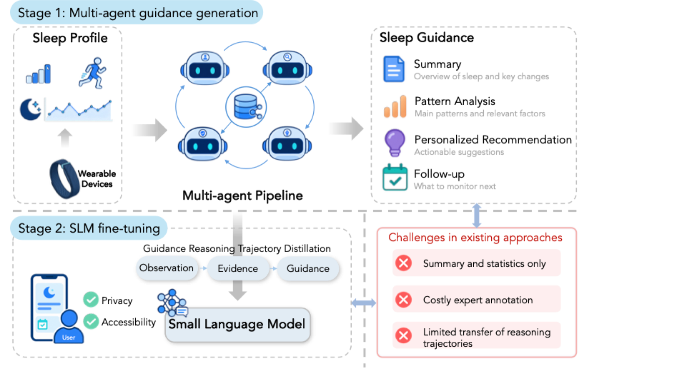

<div align="center">

# Toward Personalized Sleep Guidance from Wearable Data Using Language Models

**ML4H 2026** · [arXiv:2609.22463](https://arxiv.org/abs/2609.22463)

Yusheng Tan\*, Running Zhao\*, Sofia Angel, Ninghui Hao, Ash Arian, Nikita N. Dulin, Jay Lin, Ou Zhu,
Faiza Shaik, Xinxing Yang, Bonnie W. Leung, Katie Roster, Arlene Ruiz de Luzuriaga, Kenneth Lee,
Alejandra Lastra, Habibul Ahsan, Guihong C. Wan

</div>

<p align="center"></p>

**Stage 1** turns unannotated wearable records into evidence-grounded four-section sleep guidance
with a multi-agent LLM pipeline (Profile, Evidence, Composer and Reflection Agents).
**Stage 2** distills the guidance reasoning trajectory `[P; O; E; C; R]` into small Qwen3.5 models,
with evidence cards inserted by lookup and a training-free Best-of-N observation selection.

## Results

| Method | Evidence F1 | Value F1 | ROUGE-L | BERTScore | LLM-as-a-Judge |
|---|:-:|:-:|:-:|:-:|:-:|
| GPT-5.6-Sol | 0.288 | 0.404 | 0.251 | 0.312 | 3.48 |
| GPT Health | 0.423 | 0.398 | 0.276 | 0.331 | 3.89 |
| OpenEvidence | 0.424 | 0.261 | 0.213 | 0.264 | 3.79 |
| Guidance-only SFT (4B) | 0.629 | 0.584 | 0.474 | 0.535 | 3.97 |
| **Ours (0.8B)** | **0.680** | **0.597** | **0.502** | **0.561** | **4.08** |
| **Ours (2B)** | **0.707** | **0.609** | **0.510** | **0.567** | **4.14** |
| **Ours (4B)** | **0.711** | **0.612** | **0.506** | **0.564** | **4.11** |

300 held-out participants; fine-tuned models are means over three seeds.

## Pipeline

```bash
python scripts/build_profiles.py    --dataset <your records> --notes <field docs> --out outputs/profiles
python scripts/construct_dataset.py --profiles-dir outputs/profiles --output-dir outputs/stage1
python scripts/build_sft_data.py    --stage1-dir outputs/stage1 --out outputs/sft
accelerate launch scripts/train.py  --recipe recipes/qwen3.5-0.8b/trajectory_sft_seed1.yaml
python scripts/generate.py          --model-dir <checkpoint> --best-of-n 16 --out <generations.jsonl>
python scripts/evaluate.py          --generated <generations.jsonl> --test-file outputs/sft/trajectory/test.jsonl \
                                    --stage1-dir outputs/stage1 --output <scores.json>
python scripts/judge.py             --generated <generations.jsonl> --out <judge_dir>
```

| | |
|---|---|
| `src/sleepguide/stage1/` | Profile, Evidence, Composer and Reflection Agents; up to five verification cycles |
| `src/sleepguide/stage2/` | trajectory data, SFT, two-phase generation, Best-of-N selection |
| `src/sleepguide/evaluation/` | Evidence F1, Value F1, ROUGE-L, BERTScore, LLM judge |
| `src/sleepguide/baselines/` | GPT-5.6-Sol, GPT Health and OpenEvidence |
| `recipes/` | one config per model: trajectory, Guidance-only and Guidance-only + all 22 cards |
| `prompts/` | agent, Stage-2 task, baseline and judge prompts |
| `evidence_bank/` | the 22 evidence cards and their 46 sources |

## Data

No data or dataset-specific code is included. The Profile Agent reads your wearable records,
writes and runs its own code to build the profile packet P defined in
`prompts/stage1/profile_agent.md`, and every packet is validated before Stage 1 uses it. The
paper uses Fitbit records from the [*All of Us* Research Program](https://allofus.nih.gov/),
available to registered researchers through the Researcher Workbench.

## Citation

```bibtex
@inproceedings{tan2026sleepguidance,
  title     = {Toward Personalized Sleep Guidance from Wearable Data Using Language Models},
  author    = {Tan, Yusheng and Zhao, Running and Angel, Sofia and Hao, Ninghui and Arian, Ash and
               Dulin, Nikita N. and Lin, Jay and Zhu, Ou and Shaik, Faiza and Yang, Xinxing and
               Leung, Bonnie W. and Roster, Katie and Ruiz de Luzuriaga, Arlene and Lee, Kenneth and
               Lastra, Alejandra and Ahsan, Habibul and Wan, Guihong C.},
  booktitle = {Machine Learning for Health (ML4H)},
  year      = {2026}
}
```
